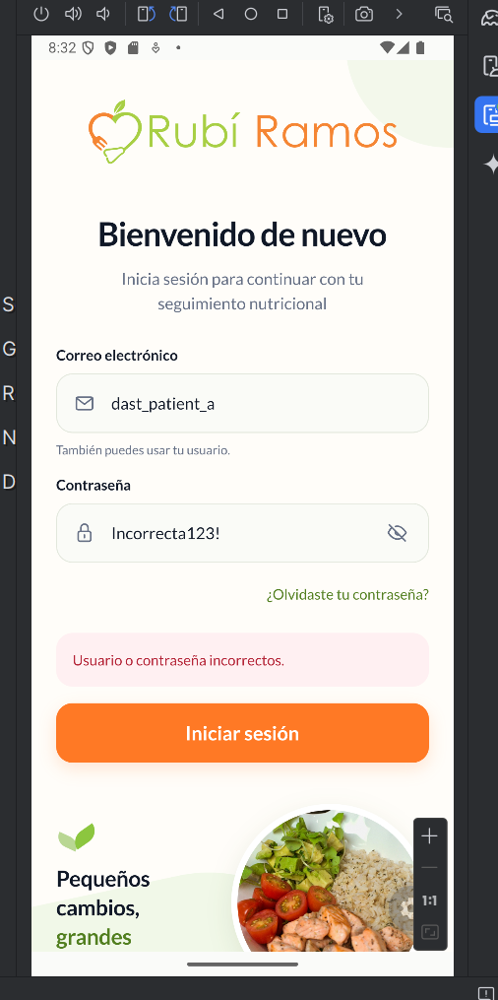

# CP01 / AUT01: inicio de sesión

**Estado general: aprobado en desarrollo, segun capturas y confirmacion del operador.** CP01-A, CP01-B, CP01-C y CP01-D tienen evidencia. El aprobado corresponde al acceso y validaciones del formulario; no acredita la carga de datos ni una compilacion Release.

## Entorno y procedencia

Evidencia recibida el 2 de noviembre de 2026. Ejecucion realizada por el operador en Android Emulator, perfil Medium Phone API 35, x86_64, identificado en la preparacion. Codex revisa las capturas y documenta los resultados aportados.

La modalidad indicada para abrir la app fue **Expo Go, desarrollo**, mediante `npm run android -- --go --clear`, con API local `http://10.0.2.2:3300`. El operador no adjunto en este paso la salida de Expo ni `git log`: el commit exacto del cliente y la version del runtime quedan pendientes de confirmar. La captura muestra la interfaz de la app en Android; no demuestra una compilacion propia Debug ni Release. La hora del dispositivo no se toma como hora local verificada de ejecucion.

Preparacion relacionada: [PREP-01, conectividad](prep-01-conectividad-emulador.md) y [PREP-02, fixtures y autenticacion HTTP](prep-02-autenticacion-local.md).

## Seguimiento de variantes

| Variante | Entradas y accion | Resultado esperado | Estado |
|---|---|---|---|
| CP01-A | Usuario y contraseña vacios; pulsar Iniciar sesión. | Mostrar `Ingresa tu usuario.` y conservar el login. | Aprobado; captura recibida. |
| CP01-B | Usuario sintetico `dast_patient_a` y contraseña vacia; pulsar Iniciar sesión. | Mostrar `Ingresa tu contraseña.` y conservar el login. | Aprobado; captura recibida. |
| CP01-C | Cuenta sintetica con contraseña incorrecta; pulsar Iniciar sesión. | Informar rechazo y conservar el acceso cerrado. | Aprobado; captura recibida. |
| CP01-D | Cuenta sintetica con credenciales correctas; pulsar Iniciar sesión. | Abrir Inicio con la cuenta sintetica indicada. | Aprobado para acceso; captura y confirmacion recibidas. |

## CP01-A: campos vacios

**Datos utilizados:** ambos campos sin texto introducido; solo se observan los placeholders `tu@correo.com` e `Ingresa tu contraseña`. No se utilizaron credenciales en esta variante.

**Pasos indicados al operador:** abrir el login, dejar ambos campos vacios y pulsar **Iniciar sesión**. El operador compartio a continuacion la siguiente captura.

**Resultado esperado:** aviso `Ingresa tu usuario.` y permanencia en la pantalla de acceso.

**Resultado observado:** se ve el formulario con ambos campos vacios y el aviso **`Ingresa tu usuario.`** en el recuadro de error. La pantalla visible sigue siendo el login, con el boton Iniciar sesión. Coincide con el resultado previsto para esta variante.

**Dictamen de la variante: aprobado.** No se observa una incidencia en la evidencia aportada.

Original recibido: `image(20261102-202223).png`. Copia sin editar, 137553 bytes. SHA-256: `6a28492892e00a277381bfa67ed1d5e15eed5be6f63323c386a2b47035c7e91f`.

## CP01-B: usuario presente y contraseña vacia

Evidencia recibida el 2 de noviembre de 2026. Se indico introducir `dast_patient_a` en el primer campo, dejar vacia la contraseña y pulsar **Iniciar sesión**.

**Resultado esperado:** mensaje `Ingresa tu contraseña.` y permanencia en el login.

**Resultado observado:** la captura muestra el usuario sintetico `dast_patient_a`, el placeholder `Ingresa tu contraseña` en el campo vacio y el aviso **`Ingresa tu contraseña.`**. Sigue visible la pantalla de acceso con el boton Iniciar sesión.

**Dictamen de la variante: aprobado.** La validacion de contraseña obligatoria se presenta como se esperaba. La captura no evidencia trafico HTTP ni una sesion creada, y no se utiliza para acreditar esos resultados.

Original recibido: `image(20261102-202841).png`. Copia sin editar, 141688 bytes. SHA-256: `1bb00d8b239de4c4bb31edd8d9fde48cc760ad94a313df268e8b266bd8131240`.

## CP01-C: credenciales incorrectas

Evidencia recibida el 2 de noviembre de 2026. Se indico conservar `dast_patient_a`, introducir el dato deliberadamente incorrecto `Incorrecta123!` y pulsar **Iniciar sesión**. Esta cadena es un dato negativo de prueba, no la contraseña valida del fixture.

**Resultado esperado:** mensaje `Usuario o contraseña incorrectos.` y permanencia en el login.

**Resultado observado:** la captura muestra ese usuario sintetico, la contraseña negativa indicada y el aviso **`Usuario o contraseña incorrectos.`**. La interfaz sigue en el login, con el boton Iniciar sesión visible.

**Dictamen de la variante: aprobado.** El rechazo visual coincide con lo esperado. La imagen no muestra el codigo HTTP ni acredita por si sola el estado del almacenamiento local.

Original recibido: `image(20261102-203224).png`. Copia sin editar, 141784 bytes. SHA-256: `a282a0555d4ef4ead15b247b8d5912eab5e1a7282ca39148a6c651097d49c1fa`.

## CP01-D: acceso valido

En el [primer bloque de cinco resultados](bloque-01-resultados.md), el operador compartio la pantalla Inicio y confirmo que las pruebas funcionaron. La contraseña valida no aparece en la captura ni se guarda en el reporte.

**Resultado observado:** se abrio Inicio, con saludo, menu y accesos. La pantalla muestra ademas avisos de paciente y plan no encontrados, documentados separadamente como **INC-ENT-01**; no se presentan como carga de datos aprobada.

**Dictamen de la variante: aprobado para el acceso.** La cuenta utilizada es la sintetica indicada en las instrucciones y confirmada por el operador; la captura de Inicio no muestra por si sola su identificador ni el token.

**Evidencia visual:** captura 4 del informe Word privado del bloque 01. La imagen no se publica en este repositorio.

El original y sus datos de integridad se conservan en el registro privado del bloque.

## Limites y siguiente paso

Las capturas no muestran trafico de red, almacenamiento ni codigos HTTP. Acreditan los estados visuales y el acceso reportado, no una inspeccion del token o del cifrado. La validacion visual no sustituye las comprobaciones internas y nativas que tienen evidencia separada.

El [primer bloque](bloque-01-resultados.md) ya se recibio y documento. Antes de los siguientes casos de perfil, progreso y planes se revisa INC-ENT-01 y la preparacion del paciente sintetico. Las variantes ya aprobadas no se repiten por cambiar el ritmo de entrega.
