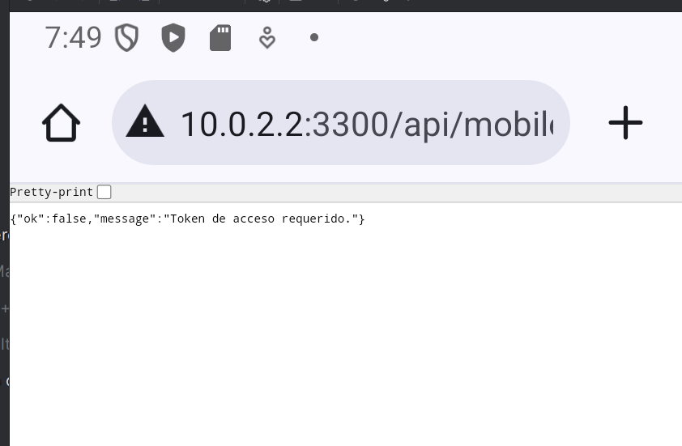

# PREP-01: conectividad del emulador con la API local

**Resultado: aprobado para preparacion del entorno.** Evidencia recibida el 2 de noviembre de 2026. La ejecucion fue realizada por el operador en su equipo Windows; Codex revisa y documenta las salidas y la captura compartidas. La hora exacta de ejecucion no se acredita con esta imagen.

## Objetivo y entorno

Comprobar que Android Emulator puede alcanzar la API aislada de pruebas mediante el puente local, y que la consulta de identidad sin token devuelve el rechazo esperado.

| Elemento | Evidencia disponible |
|---|---|
| Perfil del emulador | Medium Phone API 35, x86_64, observado previamente en Device Manager. |
| Conexion ADB | `emulator-5554 device`, salida compartida por el operador. |
| Runtime del equipo | Node 22.13.0; Docker Server 29.1.3, Linux. |
| Servicios locales | `db`, `api` y `emulator-proxy` saludables segun la salida de Compose compartida. |
| Configuracion entregada | Commit `6030cbe101946280e4d96523c9aa5cb56540475c`; el SHA del checkout del operador no aparece en la captura. |
| API/backend | Instancia local de pruebas en Docker; su commit no se verifica nuevamente en esta captura. |
| Datos empleados | Consulta sin Bearer ni credenciales; no se necesita una cuenta para este paso. |

## Procedimiento y resultado observado

1. El operador actualizo la rama de trabajo e inicio la API y el puente mediante `compose.yml` y `compose-emulator.yml`, sin reconstruir imagenes.
2. La consulta desde Windows a `http://127.0.0.1:3300/api/mobile/auth/me`, mediante `curl.exe`, devolvio **`HTTP 401`**. Este codigo consta en la salida de terminal aportada, no en la captura de Chrome.
3. Se indico abrir en Chrome del emulador `http://10.0.2.2:3300/api/mobile/auth/me`, sin token.
4. La captura muestra el host `10.0.2.2:3300`, el comienzo de la ruta `/api/mobil...` y esta respuesta:

```json
{"ok":false,"message":"Token de acceso requerido."}
```

**Resultado esperado:** recibir una respuesta de la API local que rechace la consulta sin token, en lugar de un error de conexion.

**Resultado observado:** Chrome del emulador recibio el JSON de rechazo esperado. La respuesta coincide con el rechazo sin autenticacion verificado antes desde Windows. Se acredita conectividad de extremo a extremo entre navegador del emulador, puente y API local.



Original compartido: `image(20261102-195004).png`. Copia sin editar, 33792 bytes. SHA-256: `f8a722ca6631fefab71cbb6a60959ac615446f46d228a2e78e3e132a029302bb`.

## Limites y siguiente paso

La barra de direcciones esta truncada y Chrome no muestra el codigo HTTP en la imagen; no se presenta como evidencia visual de la ruta completa ni del estado 401 en Android. El codigo de Windows y el cuerpo observado en Android se registran por separado.

Este paso no ejecuta el login de la app, una consulta con token, persistencia de datos, recuperacion por correo, pinning o pruebas Release. Los casos CP01 a CP20 mantienen su estado manual pendiente. No se acredita una nueva ejecucion de SAST/DAST con esta captura.

Sigue preparar o reponer exclusivamente las cuatro cuentas sinteticas del entorno local, comprobar sus contratos HTTP mediante `seed-auth.cjs` y `check-auth.cjs`, y abrir la app para comenzar CP01. Los reportes de autenticacion anteriores conservan su propia fecha y alcance.
